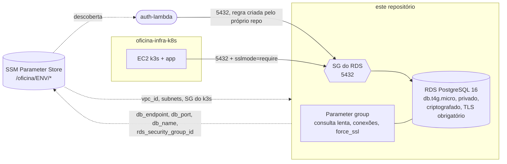

# oficina-infra-database

> ## ⚠️ Custo: o RDS não para sozinho
> O **"End Lab" do AWS Academy NÃO desliga o RDS**. Uma instância esquecida custa ≈ US$ 0,019/h
> (≈ US$ 13,70/mês) e consome o orçamento inteiro em ~3,5 meses. **Ao fim de cada sessão rode o
> workflow `destroy`** (seção [Destroy](#️-destroy)) — antes do `destroy` do `oficina-infra-k8s`.

RDS PostgreSQL gerenciado (Terraform) — Tech Challenge FIAP, Fase 3. Sustenta o requisito "Banco de
Dados Gerenciado" (R6); a justificativa da escolha do PostgreSQL está na
[RFC 0002 — Escolha do banco de dados](https://github.com/victor-duarte-mendonca/oficina-app/blob/main/docs/rfc/0002-escolha-do-banco-de-dados.md).

Repositório criado na etapa E0 a partir do histórico de `oficina/infra/rds.tf` do monorepo
[tech-challenge-fiap](https://github.com/victorduarte31/tech-challenge-fiap). A rede (VPC, subnets, SG
do k3s) vem do [oficina-infra-k8s](https://github.com/victor-duarte-mendonca/oficina-infra-k8s) via SSM.

## Tecnologias

Terraform ≥ 1.10 (backend S3 com `use_lockfile`), provider AWS 5.x, RDS PostgreSQL 16, GitHub
Actions, tflint e Trivy (IaC scan).

## Arquitetura



Decisões: instância em subnets **privadas** (`publicly_accessible = false`), sem NAT, criptografia em
repouso, `rds.force_ssl = 1` (TLS em toda conexão), `multi_az`/`deletion_protection` desligados de
propósito (lab; o `destroy` precisa funcionar). Valores de laboratório estão comentados em `rds.tf`.

## Ambientes e branches

Mesmos workspaces do `oficina-infra-k8s`, com state separado por workspace
(`s3://oficina-tfstate-<account-id>/oficina/infra-database/<workspace>/terraform.tfstate`):

| Branch    | Environment   | Workspace | Backup | Deploy                    |
|-----------|---------------|-----------|--------|---------------------------|
| `homolog` | `homologacao` | `hml`     | 0 dia  | automático no merge       |
| `main`    | `producao`    | `prod`    | 1 dia  | automático, com aprovação |

Fluxo: `feature/x` → PR para `homolog` → valida → PR `homolog` → `main`. O banco de `hml` sobe **sob
demanda** (só quando há migration ou mudança de infraestrutura a ensaiar): criar o RDS leva ~8 min.

## Pré-requisitos

- `oficina-infra-k8s` **já aplicado no mesmo workspace** — este repositório lê VPC, subnets e SG do
  k3s do SSM; sem isso o `plan` falha com `ParameterNotFound`.
- Credenciais AWS da sessão e `gh` autenticado (`set-aws-session-secrets.sh` do infra-k8s).
- **Secrets de environment** (`homologacao` e `producao`, Settings → Environments), valores seus:

  | Secret | Obrigatório | Regra |
  |---|---|---|
  | `DB_PASSWORD` | sim | ≥ 16 caracteres, sem `/`, `@`, aspas duplas ou espaço |
  | `DB_USERNAME` | não | padrão `oficina_admin` |

  ```bash
  gh secret set DB_PASSWORD --repo victor-duarte-mendonca/oficina-infra-database --env homologacao
  ```

  Use senhas diferentes por ambiente. A mesma senha precisa ser dada ao `oficina-app` (secret do
  Kubernetes) e ao Lambda de autenticação.

## Execução local

```bash
BUCKET="$(bash scripts/bootstrap-state-bucket.sh)"
terraform init -backend-config="bucket=${BUCKET}"
terraform workspace select -or-create hml
export TF_VAR_db_password='...'    # nunca commitar
terraform plan
```

Validação sem credenciais (é o que o job `validate` faz):

```bash
export TF_WORKSPACE=hml
terraform init -backend=false && terraform validate && terraform fmt -check -recursive
```

## Deploy

Pela pipeline (`.github/workflows/terraform.yml`):

| Job | Gatilho | O que faz |
|---|---|---|
| `validate` | push e PR | `fmt`, `validate`, `tflint`, `trivy config` |
| `plan` | PR | `terraform plan` no workspace do alvo e comenta o plano no PR (senha **placeholder**: ver nota) |
| `apply` | push em `homolog` / `main`; ou *Run workflow* com `confirm` vazio | `apply`, aguarda `db-instance-available` e imprime custo/hora e data-hora |
| `destroy` | `workflow_dispatch` com `confirm` preenchido | exige digitar `destroy-<workspace>`; varredura de restos por tag |

Nota sobre o `plan`: a senha real é secret de *environment*; usá-lo no `plan` pediria a aprovação do
ambiente `producao` a cada PR para `main`. Por isso o `plan` usa um valor placeholder e, numa
instância existente, mostra `password` como alterada — ruído esperado.

## Contrato SSM publicado

Sem credenciais: só host, porta e nome. Usuário e senha seguem como GitHub Secrets.

| Parâmetro | Consumidor |
|---|---|
| `/oficina/<env>/db_endpoint` | oficina-app (`DB_HOST`), auth-lambda (`DB_HOST`) |
| `/oficina/<env>/db_port` | oficina-app, auth-lambda |
| `/oficina/<env>/db_name` | oficina-app, auth-lambda |
| `/oficina/<env>/rds_security_group_id` | auth-lambda (cria a regra 5432 do seu próprio SG) |

## TLS obrigatório (mudança coordenada)

Com `rds.force_ssl = 1`, conexão sem TLS é recusada. A URL JDBC de produção da aplicação e a conexão
do Lambda precisam de `sslmode=require`. Sem isso o app **para de conectar** ao RDS.

## Custo estimado

| | `hml` | `prod` |
|---|---|---|
| RDS `db.t4g.micro` | ≈ US$ 0,016/h | ≈ US$ 0,016/h |
| Storage gp3 20 GiB | ≈ US$ 0,003/h | ≈ US$ 0,003/h |
| Backup (1 dia, ≤ storage) | — | gratuito |
| **Total** | **≈ US$ 0,019/h** | **≈ US$ 0,019/h** |
| Sessão de 4 h | ≈ US$ 0,08 | ≈ US$ 0,08 |

## ⚠️ Destroy

Ordem de encerramento (inversa à de criação): `auth-lambda` → `app` → **este repositório** →
`oficina-infra-k8s`. Este repositório precisa ser destruído **antes** do infra-k8s, que cria a VPC e o
SG que ele referencia.

Actions → `Terraform` → *Run workflow* → **Use workflow from: `homolog`** (ou `main` para prod) →
workspace e confirmação `destroy-<workspace>` (com `confirm` vazio o mesmo disparo faz *apply*). Depois confira:

```bash
aws rds describe-db-instances --query "DBInstances[].DBInstanceIdentifier"
aws resourcegroupstaggingapi get-resources --tag-filters Key=Project,Values=oficina
```

## Fora de escopo

Aurora, réplica de leitura, RDS Proxy, Multi-AZ, Performance Insights, rotação automática de senha e
migrations de schema (são da aplicação, via Flyway).

## APIs (Swagger/Postman)

Este repositório não expõe API própria (é infraestrutura). As APIs do sistema estão documentadas em [`oficina-app`](https://github.com/victor-duarte-mendonca/oficina-app):
[OpenAPI](https://github.com/victor-duarte-mendonca/oficina-app/blob/main/docs/api/openapi.yaml) · [coleção Postman](https://github.com/victor-duarte-mendonca/oficina-app/blob/main/postman/Oficina-Prod.postman_collection.json).

## URL do deploy ativo

O ambiente roda em AWS Academy (efêmero), então não há URL fixa: os endpoints são publicados no SSM (`/oficina/<env>/...`, ver "Contrato SSM publicado") e no resumo do workflow *Terraform*.

## Documentação

Documentação de decisão e de arquitetura vive em [`oficina-app`](https://github.com/victor-duarte-mendonca/oficina-app) (atravessa os quatro repositórios):

- [Arquitetura e diagramas (componentes, sequência)](https://github.com/victor-duarte-mendonca/oficina-app/blob/main/docs/arquitetura.md)
- [ADRs — decisões de arquitetura](https://github.com/victor-duarte-mendonca/oficina-app/blob/main/docs/adr/README.md) · [RFCs](https://github.com/victor-duarte-mendonca/oficina-app/blob/main/docs/rfc/)
- [Runbook de sessão e custos](https://github.com/victor-duarte-mendonca/oficina-app/blob/main/docs/RUNBOOK.md) · [Roteiro de validação em produção](https://github.com/victor-duarte-mendonca/oficina-app/blob/main/docs/VALIDACAO-PROD.md)
